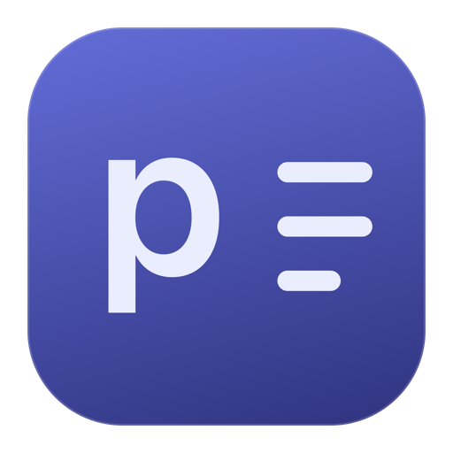
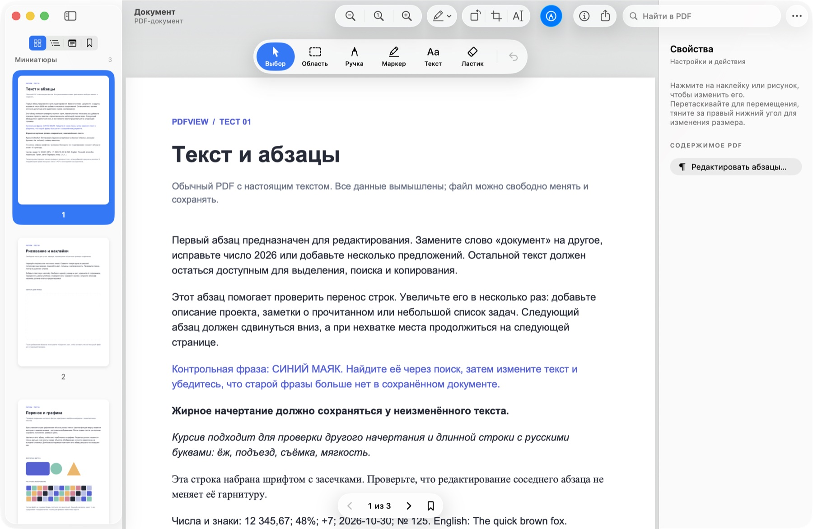
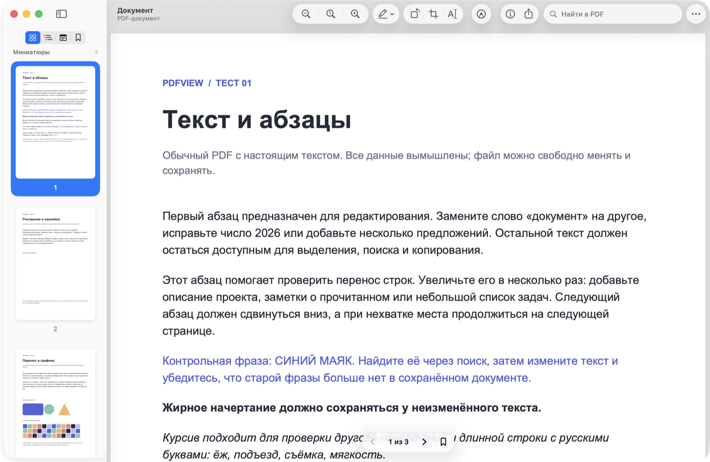

  

<h1 align="center">pdfview</h1>

A native PDF reader and editor for macOS · by <a href="https://github.com/theoron-apps">Theoron</a>

  
  
  
  
  

  <a href="../../releases/latest"><b>Download</b></a> ·
  English · <a href="README.ru.md">Русский</a> · <a href="README.uk.md">Українська</a>

  

---

## Features

- **Edit the real text** — change whole paragraphs inside the PDF, not a sticker on top. Lines re-wrap, the following text moves down and continues on new pages. The text stays searchable and selectable, and the PDF's own font is kept.
- **Invoices, tables and columns** — tables, columns and "label … value" rows move as a whole with their lines; headers and footers stay in place. Links move with their paragraph.
- **Draw and mark up** — pen and marker with colour, width and opacity, a whole-stroke eraser, text boxes with any installed font, highlight, underline and strike-through.
- **Pages** — rotate, crop to a selection, copy an area as an image or a separate PDF (content outside the area is removed, not just hidden), export a single page as PNG, JPEG, HEIC, TIFF and more.
- **Passwords and signatures** — open with a known password and save a copy without it. Protection never disappears silently, and pdfview warns before overwriting a signed PDF.
- **Liquid Glass** — the toolbar, sidebar and inspector are native macOS components, so on macOS 26 the glass is the real one, like in Preview.
- **Bookmarks, outline, thumbnails, search**, three page layouts, a document inspector.
- **What's New** after every update and **automatic update checks** once a day.
- Works offline. The only network request is the update check, and it can be turned off.

  

## Install

1. Download `pdfview-<version>.dmg` from [Releases](../../releases/latest).
2. Open it and drag **pdfview** to **Applications**.
3. pdfview is not notarized yet, so macOS asks before the first launch:
   - **macOS 15 and later:** open pdfview, click **Done**, then go to **System Settings → Privacy & Security** and click **Open Anyway**.
   - **macOS 12–14:** Control-click pdfview in Applications, choose **Open**, then **Open** again.
4. To open PDFs from Finder with pdfview: **pdfview → Настройки → Программа по умолчанию** (Settings → Default app; the interface is in Russian for now).

To update, download the new DMG and replace the app in Applications. pdfview tells you when a new version is out.

## Requirements

- macOS 12 Monterey or later
- Apple Silicon or Intel (one universal app)

## Good to know

- The interface is in Russian for now. English and Ukrainian are planned.
- Paragraph editing works with PDFs that contain real text. Scans (OCR) are not supported yet.
- Some PDFs have characters without a text mapping (often hyphens or brackets). pdfview protects such paragraphs instead of silently losing those characters.
- Saving rewrites the whole file. That invalidates digital signatures, which is why pdfview offers to save a copy of signed documents.

## Privacy

pdfview doesn't collect anything. Documents never leave your Mac. Once a day the app asks the GitHub API for the list of pdfview releases; turn it off in **Настройки → Обновления** (Settings → Updates).

## Third-party software

PDF engine: [PDFium](https://pdfium.googlesource.com/pdfium/) (BSD 3-Clause), built by [bblanchon/pdfium-binaries](https://github.com/bblanchon/pdfium-binaries) (MIT), with FreeType, HarfBuzz, ICU, libjpeg-turbo, libpng, zlib, OpenJPEG, Little CMS, Abseil and others. Full license texts are inside the app: **pdfview → Лицензии сторонних компонентов** (Third-party licenses).
