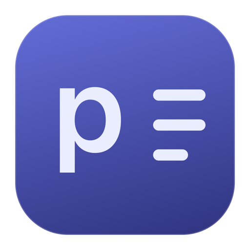
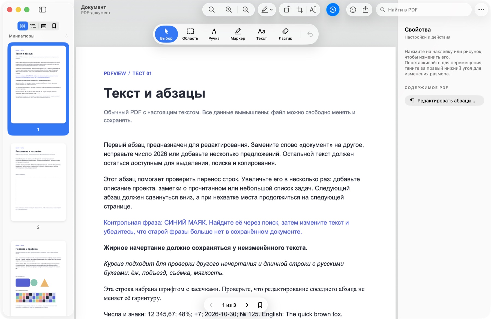
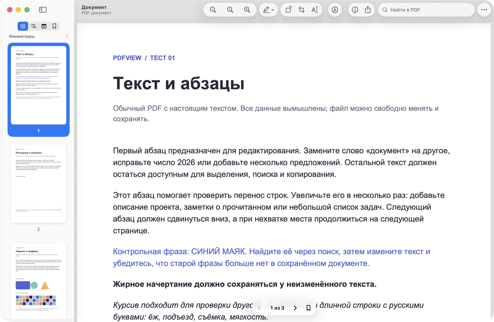

  

<h1 align="center">pdfview</h1>

Нативная программа для чтения и правки PDF на macOS · <a href="https://github.com/theoron-apps">Theoron</a>

  
  
  
  
  

  <a href="../../releases/latest"><b>Скачать</b></a> ·
  <a href="README.md">English</a> · Русский · <a href="README.uk.md">Українська</a>

  

---

## Возможности

- **Правка настоящего текста** — меняйте абзацы целиком внутри PDF, а не наклейкой поверх. Строки перестраиваются, следующий текст сдвигается и при нужде переходит на новые страницы. Текст остаётся текстом: ищется и выделяется, шрифт берётся из самого PDF.
- **Счета, таблицы и колонки** — таблицы, колонки и строки «подпись … значение» сдвигаются целиком вместе со своими линиями, колонтитулы остаются на месте. Ссылки едут вместе со своим абзацем.
- **Рисование и разметка** — ручка и маркер с цветом, толщиной и прозрачностью, ластик целого штриха, текстовые наклейки любым установленным шрифтом, выделение, подчёркивание и зачёркивание.
- **Страницы** — поворот, обрезка по выделению, копия области как картинки или отдельного PDF (лишнее удаляется, а не просто прячется), экспорт одной страницы в PNG, JPEG, HEIC, TIFF и другие форматы.
- **Пароли и подписи** — открытие с известным паролем и копия без него. Защита не пропадает молча, а перед перезаписью подписанного PDF pdfview предупреждает.
- **Liquid Glass** — панель инструментов, боковая панель и инспектор — системные компоненты macOS, поэтому на macOS 26 стекло настоящее, как в «Просмотре».
- **Закладки, оглавление, миниатюры, поиск**, три режима страниц, инспектор документа.
- **«Что нового»** после каждого обновления и **автопроверка обновлений** раз в день.
- Работает офлайн. Единственный сетевой запрос — проверка обновлений, её можно выключить.

  

## Установка

1. Скачайте `pdfview-<версия>.dmg` в [Releases](../../releases/latest).
2. Откройте его и перетащите **pdfview** в **Applications**.
3. pdfview пока не нотаризован, поэтому macOS спросит перед первым запуском:
   - **macOS 15 и новее:** откройте pdfview, нажмите **Готово**, затем **Системные настройки → Конфиденциальность и безопасность → Всё равно открыть**.
   - **macOS 12–14:** в «Программах» нажмите на pdfview с Control, выберите **Открыть** и ещё раз **Открыть**.
4. Чтобы PDF из Finder открывались в pdfview: **pdfview → Настройки → Программа по умолчанию**.

Для обновления скачайте новый DMG и замените приложение в «Программах». pdfview сам сообщит о новой версии.

## Требования

- macOS 12 Monterey или новее
- Apple Silicon или Intel (одно универсальное приложение)

## Важно знать

- Интерфейс пока на русском. Английский и украинский — в планах.
- Правка абзацев работает с PDF, в которых есть настоящий текст. Сканы (OCR) пока не поддерживаются.
- В некоторых PDF у символов нет текстовой кодировки (часто это дефисы или скобки). Такие абзацы pdfview защищает от правки, чтобы символы не пропали молча.
- Сохранение перезаписывает файл целиком. Цифровые подписи при этом теряют силу, поэтому для подписанных документов pdfview предлагает сохранить копию.

## Конфиденциальность

pdfview ничего не собирает. Документы не покидают ваш Mac. Раз в день приложение запрашивает у GitHub API список выпусков pdfview; это выключается в **Настройки → Обновления**.

## Сторонние компоненты

PDF-движок: [PDFium](https://pdfium.googlesource.com/pdfium/) (BSD 3-Clause) в сборке [bblanchon/pdfium-binaries](https://github.com/bblanchon/pdfium-binaries) (MIT), с FreeType, HarfBuzz, ICU, libjpeg-turbo, libpng, zlib, OpenJPEG, Little CMS, Abseil и другими. Полные тексты лицензий — в приложении: **pdfview → Лицензии сторонних компонентов**.
