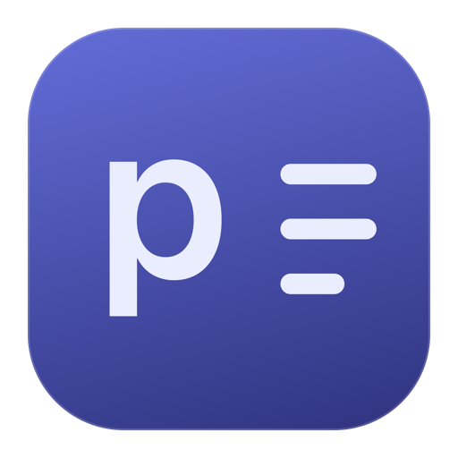
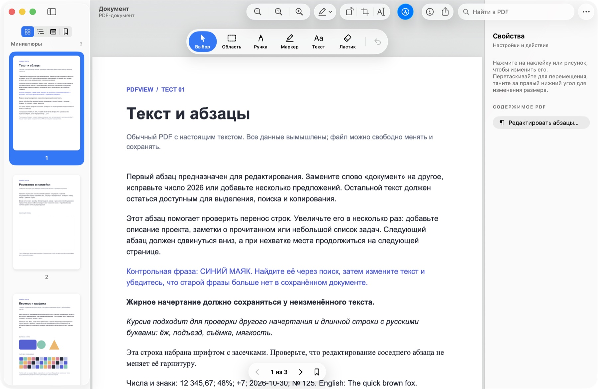
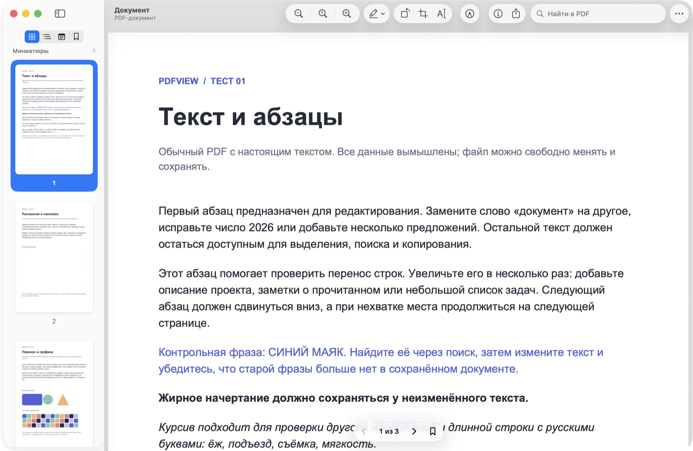

  

<h1 align="center">pdfview</h1>

Нативна програма для читання й редагування PDF на macOS · <a href="https://github.com/theoron-apps">Theoron</a>

  
  
  
  
  

  <a href="../../releases/latest"><b>Завантажити</b></a> ·
  <a href="README.md">English</a> · <a href="README.ru.md">Русский</a> · Українська

  

---

## Можливості

- **Редагування справжнього тексту** — змінюйте абзаци цілком усередині PDF, а не наліпкою зверху. Рядки перебудовуються, наступний текст зсувається й за потреби переходить на нові сторінки. Текст лишається текстом: його можна шукати й виділяти, шрифт береться з самого PDF.
- **Рахунки, таблиці й колонки** — таблиці, колонки та рядки «підпис … значення» зсуваються цілком разом зі своїми лініями, колонтитули лишаються на місці. Посилання їдуть разом зі своїм абзацом.
- **Малювання й розмітка** — ручка та маркер із кольором, товщиною й прозорістю, гумка цілого штриха, текстові наліпки будь-яким встановленим шрифтом, виділення, підкреслення й закреслення.
- **Сторінки** — поворот, обрізання за виділенням, копія області як зображення або окремого PDF (зайве видаляється, а не просто ховається), експорт однієї сторінки в PNG, JPEG, HEIC, TIFF та інші формати.
- **Паролі й підписи** — відкриття з відомим паролем і копія без нього. Захист не зникає мовчки, а перед перезаписом підписаного PDF pdfview попереджає.
- **Liquid Glass** — панель інструментів, бічна панель та інспектор — системні компоненти macOS, тож на macOS 26 скло справжнє, як у «Перегляді».
- **Закладки, зміст, мініатюри, пошук**, три режими сторінок, інспектор документа.
- **«Що нового»** після кожного оновлення та **автоперевірка оновлень** раз на день.
- Працює офлайн. Єдиний мережевий запит — перевірка оновлень, її можна вимкнути.

  

## Встановлення

1. Завантажте `pdfview-<версія>.dmg` у [Releases](../../releases/latest).
2. Відкрийте його й перетягніть **pdfview** до **Applications**.
3. pdfview поки не нотаризовано, тож macOS запитає перед першим запуском:
   - **macOS 15 і новіші:** відкрийте pdfview, натисніть **Готово**, потім **Системні параметри → Приватність і безпека → Усе одно відкрити**.
   - **macOS 12–14:** у «Програмах» натисніть на pdfview із Control, виберіть **Відкрити** і ще раз **Відкрити**.
4. Щоб PDF із Finder відкривалися в pdfview: **pdfview → Налаштування → Програма за замовчуванням**.

Щоб оновити, завантажте новий DMG і замініть програму в «Програмах». pdfview сам повідомить про нову версію.

## Вимоги

- macOS 12 Monterey або новіша
- Apple Silicon або Intel (одна універсальна програма)

## Варто знати

- Інтерфейс поки російською. Англійська та українська — у планах.
- Редагування абзаців працює з PDF, у яких є справжній текст. Скани (OCR) поки не підтримуються.
- У деяких PDF символи не мають текстового кодування (часто це дефіси або дужки). Такі абзаци pdfview захищає від редагування, щоб символи не зникли мовчки.
- Збереження перезаписує файл цілком. Цифрові підписи при цьому втрачають чинність, тому для підписаних документів pdfview пропонує зберегти копію.

## Приватність

pdfview нічого не збирає. Документи не залишають ваш Mac. Раз на день програма запитує в GitHub API список випусків pdfview; це вимикається в **Налаштування → Оновлення**.

## Сторонні компоненти

PDF-рушій: [PDFium](https://pdfium.googlesource.com/pdfium/) (BSD 3-Clause) у збірці [bblanchon/pdfium-binaries](https://github.com/bblanchon/pdfium-binaries) (MIT), із FreeType, HarfBuzz, ICU, libjpeg-turbo, libpng, zlib, OpenJPEG, Little CMS, Abseil та іншими. Повні тексти ліцензій — у програмі: **pdfview → Лицензии сторонних компонентов**.
